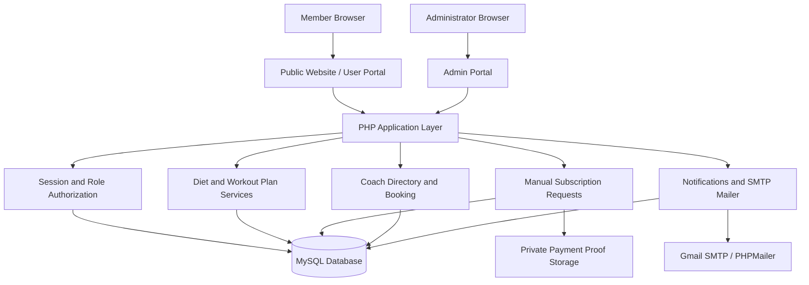
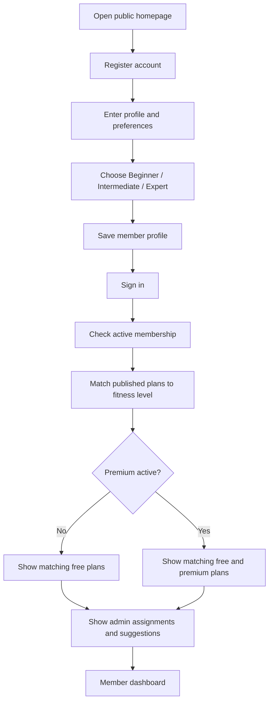
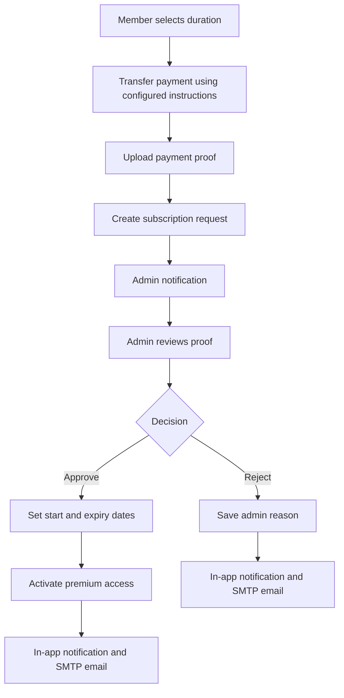
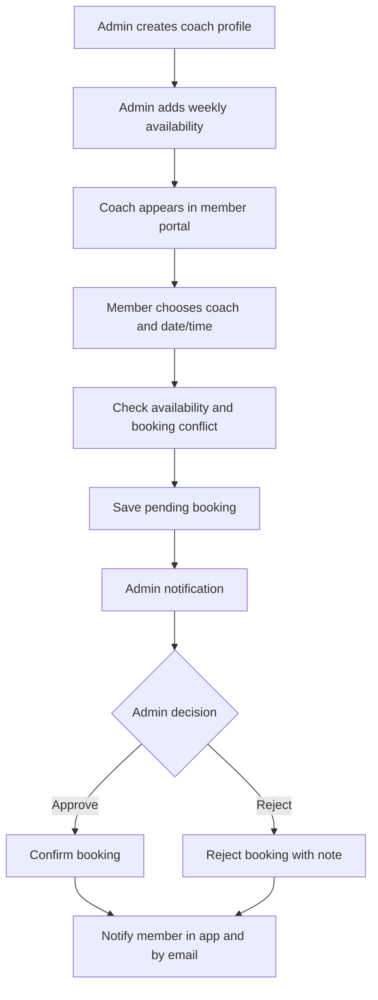
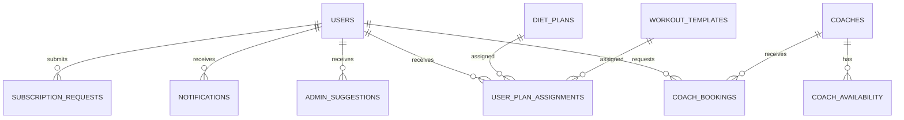

# FitTrack 2.0 – System Diagrams

## 1. System architecture

## 2. Registration and personalized content flow

## 3. Manual subscription workflow

## 4. Coaching workflow

## 5. Role and content access rules

| Area | Member | Administrator |
|---|---|---|
| Public homepage | View | View |
| Personal profile and logs | Own records | View member records |
| Diet/workout content | Matching level and membership | Create and publish |
| Premium content | Active Premium only | Manage content |
| Subscription request | Submit proof and view own status | Review and decide |
| Coach directory | View and request | Create and deactivate |
| Coach bookings | View own requests | Review all requests |
| Suggestions | View own suggestions | Create for members |
| Admin dashboard | No access | Full admin access |

## 6. Main database relationships

The additive migration is in `database/fittrack_2_migration.sql`. Back up the existing database before importing it.
